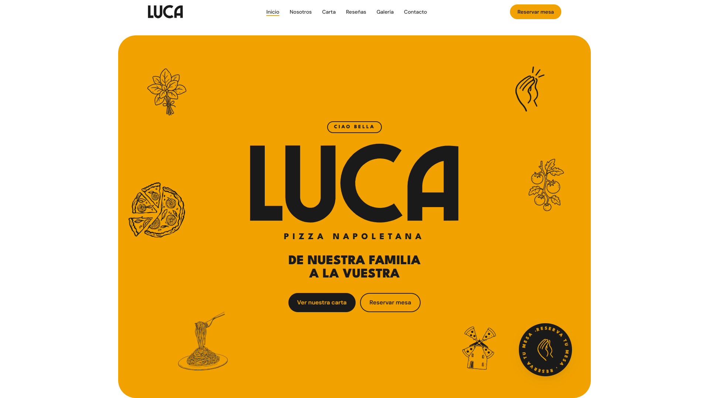
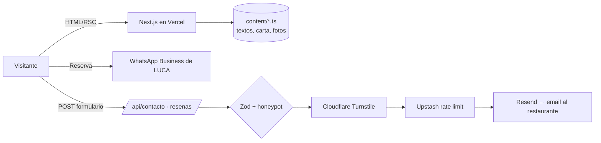

<div align="center">

# LUCA — Pizza Napoletana

**Pizza napolitana artesana en Valdepeñas (Ciudad Real).**
Sitio web oficial: carta, galería, historia familiar, reseñas y reservas.

[](https://lucapizzerianapoletana.es)
[](https://vercel.com)




</div>

---

## Índice

- [Sobre el proyecto](#sobre-el-proyecto)
- [Características](#características)
- [Stack tecnológico](#stack-tecnológico)
- [Arquitectura](#arquitectura)
- [Estructura del repositorio](#estructura-del-repositorio)
- [Puesta en marcha](#puesta-en-marcha)
- [Variables de entorno](#variables-de-entorno)
- [Scripts](#scripts)
- [Seguridad](#seguridad)
- [Despliegue](#despliegue)
- [Identidad visual](#identidad-visual)
- [Hoja de ruta](#hoja-de-ruta)
- [Licencia](#licencia)

---

## Sobre el proyecto

**LUCA** es una pizzería napolitana familiar con masa de larga fermentación (72 h)
e ingredientes de calidad. Esta web presenta la marca, la carta, la historia de la
familia y la obra del local, y facilita el contacto y las reservas.

- Multipágina, **mobile-first** y totalmente en español.
- Animaciones cuidadas, con soporte de `prefers-reduced-motion`.
- **Sin cuentas ni autenticación**: los formularios llegan por email al restaurante.

## Características

| Página | Ruta | Lo más destacado |
|---|---|---|
| Inicio | `/` | Telón de entrada con el logo animado, wordmark con letras que saltan, dibujos de marca interactivos, pizza que gira con el scroll, tickets de proceso y carrusel circular |
| Nosotros | `/nosotros` | Foto en arco que se abre, texto que se ilumina con el scroll, contador de 72 h y scroll horizontal con *polaroids* en vídeo (Live Photos) |
| Carta | `/carta` | Navegación *sticky* por categorías, pizza destacada y platos en formato ticket interactivo |
| Galería | `/galeria` | 49 fotos en 6 temas, filtros, *masonry* y visor accesible con `<dialog>` |
| Reseñas | `/resenas` | Muro de reseñas reales que se acelera con el scroll y formulario con valoración, fotos y anti-spam |
| Contacto | `/contacto` | Datos de contacto, horarios, mapa de Google Maps y formulario |
| Reservar | `/reservar` | Formulario de reserva validado por día y franja horaria |
| Legal | `/aviso-legal` · `/privacidad` · `/cookies` | Textos legales enlazados entre sí |

**SEO**: metadatos por página, imagen Open Graph generada, `sitemap.xml`, `robots.txt`,
datos estructurados JSON-LD (`Restaurant`) e iconos.

## Stack tecnológico

| Capa | Tecnología |
|---|---|
| Framework | [Next.js 15](https://nextjs.org) (App Router) + React 19 + TypeScript estricto |
| Estilos | [Tailwind CSS 4](https://tailwindcss.com) (tokens en `@theme`) + patrones shadcn/ui · CVA |
| Animación | [Motion](https://motion.dev) |
| Formularios | [React Hook Form](https://react-hook-form.com) + [Zod](https://zod.dev) (esquemas compartidos cliente/servidor) |
| Email | [Resend](https://resend.com) |
| Anti-spam | [Cloudflare Turnstile](https://www.cloudflare.com/products/turnstile/) + honeypot |
| Rate limit | [Upstash Redis](https://upstash.com) |
| Base de datos | Postgres (Neon) + Drizzle ORM — *preparado para reservas por franjas* |
| Calidad | ESLint · Prettier · `tsc --noEmit` |
| Hosting | [Vercel](https://vercel.com) |

## Arquitectura



- **Contenido como datos**: todo el texto, la carta y las fotos viven en archivos
  tipados en `content/`; los componentes nunca llevan texto escrito a mano.
- **Componentes de servidor por defecto**: solo usan `"use client"` los que tienen estado
  (formularios, galería, navegación).
- **Un único manejador de formularios** (`lib/server/form-handler`) aplica la misma cadena
  de validación y seguridad a los tres endpoints.

## Estructura del repositorio

```
app/                    Rutas (una carpeta por página) + layout, SEO y API
  api/{contacto,resenas}/route.ts
components/
  layout/               Navbar, Footer
  sections/<página>/    Secciones de cada página
  forms/                Formularios, Turnstile, useApiForm
  ui/                   Piezas base y animadas (Button, Reveal, LucaLogo, ScrollText…)
content/                Textos, carta (menu.ts), fotos y dibujos de marca
lib/
  server/               Solo servidor: env, Turnstile, rate limit, Resend
  validations/          Esquemas Zod
  utils/                Utilidades (precios, fechas, enlaces de contacto)
design/                 Fuente de verdad de marca (*.md, logos, carteles)
public/images · videos  Recursos optimizados (WebP / MP4)
site.config.ts          Marca, navegación, contacto, horarios y redes
```

## Puesta en marcha

**Requisitos:** Node.js 20 o superior y [pnpm](https://pnpm.io).

```bash
git clone https://github.com/alexislarem/Pizzeria_Nap_Lucca.git
cd Pizzeria_Nap_Lucca
pnpm install
cp .env.example .env.local   # rellena las claves (ver abajo)
pnpm dev                     # http://localhost:3000
```

> En local puedes usar las **claves de prueba de Turnstile** indicadas en `.env.example`
> (siempre aprueban).

## Variables de entorno

| Variable | Uso | Pública |
|---|---|:---:|
| `NEXT_PUBLIC_URL` | URL canónica del sitio | ✅ |
| `RESEND_API_KEY` | API de Resend | — |
| `RESEND_FROM_EMAIL` | Remitente (dominio verificado en Resend) | — |
| `RESEND_TO_EMAIL` | Buzón que recibe contactos y reseñas (las reservas van por WhatsApp) | — |
| `NEXT_PUBLIC_TURNSTILE_SITE_KEY` | Widget de Turnstile | ✅ |
| `TURNSTILE_SECRET_KEY` | Verificación de Turnstile en servidor | — |
| `UPSTASH_REDIS_REST_URL` | Redis para el límite de envíos | — |
| `UPSTASH_REDIS_REST_TOKEN` | Token de Upstash | — |
| `DATABASE_URL` | Postgres (Neon) — opcional, fase de reservas por franjas | — |

Los secretos solo viven en `.env.local` (ignorado por git) y en el panel de Vercel.

## Scripts

| Comando | Descripción |
|---|---|
| `pnpm dev` | Servidor de desarrollo |
| `pnpm build` | Compilación de producción |
| `pnpm start` | Sirve la compilación |
| `pnpm lint` | ESLint |
| `pnpm typecheck` | Comprobación de tipos (`tsc --noEmit`) |
| `pnpm format` | Formatea con Prettier |
| `NEXT_DIST_DIR=.next-check pnpm build` | Compila sin pisar la `.next` de `pnpm dev` |

## Seguridad

- Validación **Zod** en cliente y servidor con los mismos esquemas.
- **Honeypot** + **Cloudflare Turnstile** contra bots.
- **Rate limit** por IP y formulario con Upstash (5 envíos / 10 min).
- Saneado de los datos antes de construir los emails.
- Cabeceras de seguridad configuradas en `next.config.ts`.
- Ningún secreto expuesto al navegador (solo las variables `NEXT_PUBLIC_*`).

## Despliegue

El proyecto se despliega en **Vercel** conectado a este repositorio:

- `main` → producción en **[lucapizzerianapoletana.es](https://lucapizzerianapoletana.es)**
- Cualquier otra rama o PR → vista previa automática

Las variables de entorno se configuran en *Vercel → Settings → Environment Variables*.
Recuerda que las `NEXT_PUBLIC_*` se incrustan al compilar: tras cambiarlas, vuelve a desplegar.

## Identidad visual

| Token | Valor | Uso |
|---|---|---|
| `primary` |  | Amarillo LUCA, color de marca |
| `accent` |  | Precios, errores, enlaces secundarios |
| `surface` | Crema | Fondos |
| Display | League Spartan Black | Titulares en mayúsculas |
| Texto | DM Sans | Cuerpo |

La fuente de verdad de la marca está en [`design/`](design/). Los tokens viven
únicamente en el bloque `@theme` de `app/globals.css`.

## Hoja de ruta

- [x] Diseño multipágina con fotos reales
- [x] Formularios con email, anti-spam y rate limit
- [x] Galería con filtros y visor
- [x] SEO: Open Graph, sitemap, robots y JSON-LD
- [x] Dominio propio en Vercel
- [ ] Reservas con franjas disponibles (Neon + Drizzle)
- [ ] Publicación automática de reseñas tras moderación
- [ ] Auditoría Lighthouse y CSP estricta

## Licencia

Código publicado bajo licencia [MIT](LICENSE).
Las fotografías, logotipos, dibujos y la marca **LUCA** son propiedad de sus titulares
y **no** están cubiertos por esa licencia.

<div align="center">
<br/>
Hecho con 🍕 y masa de 72 horas en Valdepeñas.
</div>
